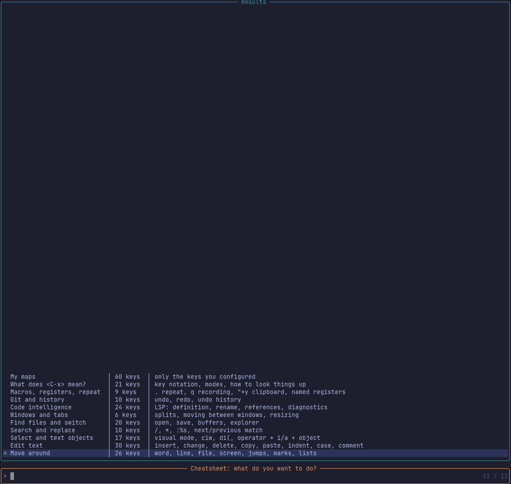
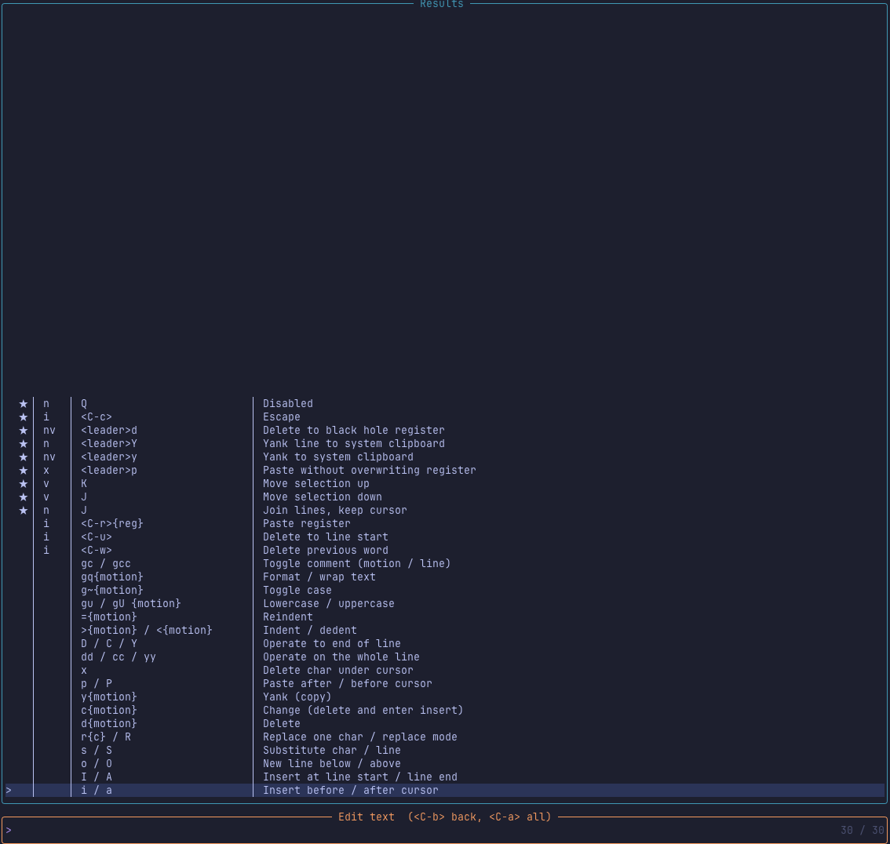
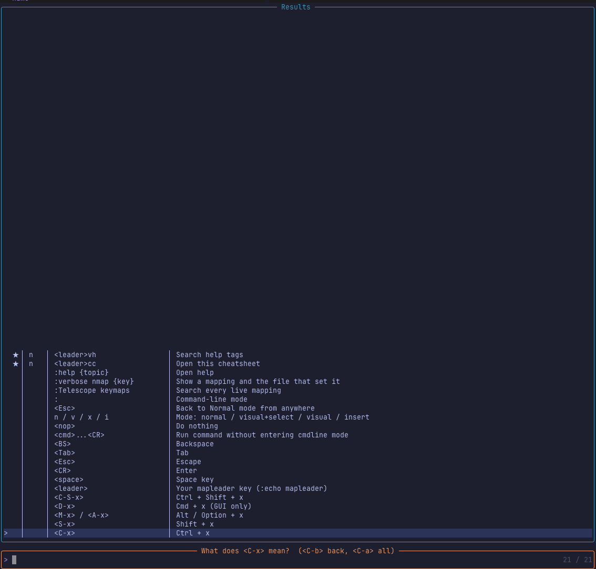

# cheatsheet.nvim

A searchable keybinding cheatsheet for Neovim, built on Telescope. It's made for the moment when you don't know what key you want, only what you want to do.

Open it and you get a short list of tasks: move around, edit text, search and replace, and so on. Pick one and you see only the keys for that task. Every key also has hidden search words, so typing `delete` or `rename` finds the right keys even when the description says something else.

## Screenshots

Step 1: pick what you want to do.



Step 2: browse only the keys for that task. Your own keys are marked with a star.



Not sure what `<C-x>` or `<leader>` means? There's a category for that.



## Features

- Two steps: pick a task first, then browse its keys. `<C-a>` searches everything at once, `<C-b>` goes back.
- Built-in reference for Vim motions, operators, text objects, registers, macros, windows, and key notation (what `<C-x>` or `<leader>` means).
- Your own maps live next to the built-in ones, marked with `★`, and also collect under "My maps".
- Sync check: maps set in your config that you forgot to add show up under "Unlisted maps".
- Enter on a key copies it to your clipboard.

## Requirements

- Neovim 0.10 or newer (developed and tested on 0.12)
- [telescope.nvim](https://github.com/nvim-telescope/telescope.nvim)

## Install

With [lazy.nvim](https://github.com/folke/lazy.nvim):

```lua
{
    "alexcloudstar/cheatsheet.nvim",
    dependencies = { "nvim-telescope/telescope.nvim" },
    opts = {},
}
```

Then run `:Cheatsheet` or press `<leader>cc`.

## Add your own keys

Pass categories to `setup`. Entries in a category with an existing `id` are added to it. A new `id` creates a new category. Entries you add are marked as yours (`★`) unless you set `custom = false`.

```lua
{
    "alexcloudstar/cheatsheet.nvim",
    dependencies = { "nvim-telescope/telescope.nvim" },
    opts = {
        aliases = { "Cc" },
        categories = {
            {
                id = "files",
                entries = {
                    { key = "<leader>pf", desc = "Find files", tags = "open fuzzy telescope" },
                    { key = "<C-p>", desc = "Git files" },
                },
            },
            {
                id = "docker",
                label = "Docker",
                desc = "container shortcuts",
                tags = "container compose",
                entries = {
                    { key = "<leader>dd", desc = "Docker compose up" },
                },
            },
        },
    },
}
```

Entry fields:

| Field | Meaning |
| --- | --- |
| `key` | The key as you'd write it in a mapping, like `<leader>pf` or `<C-d>` |
| `desc` | What it does |
| `tags` | Extra words that should find this key (optional) |
| `modes` | Mode letters, like `"n"`, `"nv"` or `"i"`. Defaults to `"n"` |
| `custom` | `false` to show it as a built-in key instead of one of yours |

If you add a key that matches a built-in entry (same key and mode), yours replaces it.

## Options

```lua
{
    open_key = "<leader>cc",
    aliases = {},
    categories = {},
    detect_unlisted = true,
    config_dir = nil,
    copy_register = "+",
    back_key = "<C-b>",
    all_key = "<C-a>",
}
```

| Option | Meaning |
| --- | --- |
| `open_key` | Normal-mode key that opens the cheatsheet. `false` to skip the mapping |
| `aliases` | Extra command names, like `{ "Cc" }`. `:Cheatsheet` always exists |
| `categories` | Your categories and entries, see above |
| `detect_unlisted` | Show maps from your config that aren't in the cheatsheet |
| `config_dir` | Directory that counts as "your config" for the sync check. Defaults to `stdpath("config")` |
| `copy_register` | Register that Enter copies the key into |
| `back_key`, `all_key` | Keys inside the picker |

## How the sync check works

When the cheatsheet opens, it reads the live mappings and keeps the ones defined in a file under `config_dir`. Any that aren't in your cheatsheet entries are listed under "Unlisted maps". Maps from plugins and Neovim defaults are ignored. Buffer-local maps only show up when you open the cheatsheet from a buffer that has them.

## Commands

| Command | Action |
| --- | --- |
| `:Cheatsheet` | Open the cheatsheet |

## License

MIT
